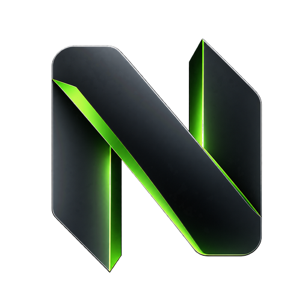
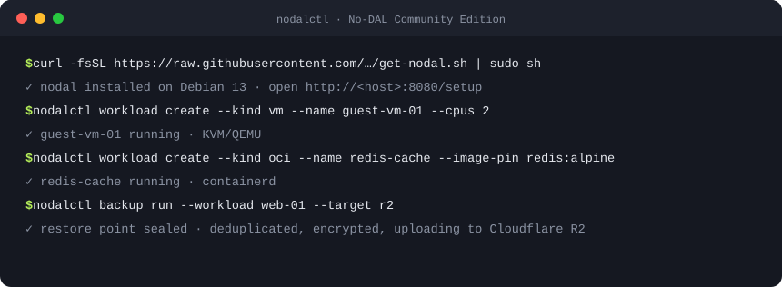

<div align="center">

<a href="https://no-dal.com"></a>

# No-DAL Community Edition

**The open-source Linux hypervisor that runs your whole homelab.**

Your infrastructure. Your rules. Everything else? No deal.

[](https://no-dal.com)
[](https://github.com/ASPEC-RACING-PTY-LTD/ndl-ce/releases)
[](https://no-dal.com/get-started)
[](packaging/debian/copyright)

[Website](https://no-dal.com) · [Get started](https://no-dal.com/get-started) · [Features](https://no-dal.com/features) · [Docs](https://no-dal.com/docs) · [Architecture](https://no-dal.com/docs/architecture)

<br>



</div>

## What is No-DAL?

No-DAL, also written NoDAL, No DAL or Nodal, is a self-hosted Linux
hypervisor and infrastructure platform built on stock Debian 13. One
control plane, API, CLI and web UI run your virtual machines, containers,
game servers, storage, networking and backups.

- **No black-box appliance OS.** The host stays ordinary Debian with its own
  kernel and packages: KVM/QEMU, liblxc, containerd, systemd-networkd,
  dnsmasq, nftables, ZFS and LVM.
- **Built to keep running.** A lean, privileged node agent does the work
  through typed operations only, managed by an unprivileged control plane
  with its state in PostgreSQL. Guests are systemd units that keep running
  if the API or agent restarts.
- **In production.** No-DAL is past 1.0 and runs a homelab of more than 40
  projects every day.

## Features

| | |
| --- | --- |
| **Virtual machines** | KVM/QEMU guests under systemd with qcow2, ZFS or LVM-thin disks, snapshots, cloud-init and VFIO GPU passthrough. |
| **System containers** | LXC, unprivileged by default, with templates, live disk growth, nested Docker and GPU assignment for AI workloads or Plex and Jellyfin transcoding. |
| **OCI containers** | Native OCI application containers via containerd, each with its own IP, ports and volumes. Create from an image or a Compose file. |
| **Game servers** | 187 built-in templates, Pelican and Pterodactyl egg import, a console, files, a mod browser, backups and schedules. |
| **Backups** | Backup Engine V2: deduplicated, incremental and encrypted before upload to S3 or Cloudflare R2, with Git-aware capture, retention, verification and whole-platform disaster recovery. |
| **Docker** | Docker Management for host engines and nested Docker, Git Deployments for Compose projects and Uptime monitors that restart failing containers. |
| **Storage** | Directory, ZFS, LVM-thin, NFS, SMB and iSCSI pools, plus host disk protection that keeps the database up when the root disk fills. |
| **Networking** | Isolated, NAT and LAN-bridge networks with VLANs, bonds, WireGuard and a rollback watchdog, a Cloudflare Tunnel manager and Caddy and Nginx sites. |
| **Access** | User, Admin and SuperAdmin roles, custom roles and groups, approvals, TOTP MFA, service accounts, API tokens and a full audit log. |
| **Operations** | Signed live updates with automatic rollback, automation flows, a browser terminal and file manager, global search and clustering. |

See every feature at **[no-dal.com/features](https://no-dal.com/features)**.

## Install

On a Debian 13 amd64 machine:

```bash
curl -fsSL https://raw.githubusercontent.com/ASPEC-RACING-PTY-LTD/ndl-ce/main/packaging/bootstrap/get-nodal.sh | sudo sh
```

The bootstrap installs the `nodal` package from the signed Debian
repository, waits until the services are healthy and prints the setup
address. Open it in a browser to create the first SuperAdmin. Updates
install from the Updates page or with `nodalctl update`.

Full guide: [no-dal.com/get-started](https://no-dal.com/get-started) and
[docs/install.md](docs/install.md).

## Use it from the terminal

`nodalctl` speaks the same API as the web UI:

```bash
nodalctl feature enable oci
nodalctl workload create --kind vm --name guest-vm-01 \
  --cloud-image-id IMAGE --pool-id POOL --network-id NET --cpus 2
nodalctl workload create --kind oci --name redis-cache \
  --image-pin docker.io/library/redis:alpine --network-id NET
nodalctl snapshot create --workload ID --name before-upgrade
nodalctl backup run --workload ID --target TARGET
```

## Documentation

| Topic | Guide |
| --- | --- |
| Install and remove | [Install](docs/install.md) · [Uninstall](docs/uninstall.md) |
| Workloads | [Lifecycle](docs/workload-lifecycle.md) · [Guest baseline](docs/guest-baseline.md) · [Game servers](docs/game-servers-catalogue.md) |
| Backups | [Backups](docs/backup.md) · [Backup Engine V2](docs/backup-engine-v2.md) · [Platform backup](docs/platform-backup.md) · [Recovery](docs/recovery.md) |
| Containers and apps | [Docker](docs/docker.md) · [Deployments](docs/deployments.md) · [Store](docs/store.md) |
| Networking | [Edge forwarding](docs/edge-forwarding.md) · [DDoS protection](docs/ddos-protection.md) · [Cloudflare](docs/cloudflare.md) · [Caddy and Nginx](docs/reverse-proxies.md) |
| Administration | [Management](docs/management.md) · [Live updates](docs/live-updates.md) · [Cluster](docs/cluster.md) · [Migration](docs/migration.md) |
| Extras | [AI](docs/ai.md) · [CodeHold](docs/codehold.md) · [API compatibility](docs/api-compatibility.md) |

The public guide lives at **[no-dal.com/docs](https://no-dal.com/docs)**.

## Community and Enterprise

Community Edition is free and open source with no node limits and no
licence key. [Enterprise Edition](https://no-dal.com/enterprise) adds
commercial support on the same platform.
[Contact sales](https://no-dal.com/contact/sales) or
[get in touch](https://no-dal.com/contact).

## Contributing

Building from source, running the checks and cutting releases are covered
in [CONTRIBUTING.md](CONTRIBUTING.md).

<div align="center">
<br>
<sub>Built by <a href="https://aspecracing.com.au/">ASPEC RACING PTY LTD</a> · <a href="https://no-dal.com">no-dal.com</a></sub>
</div>
